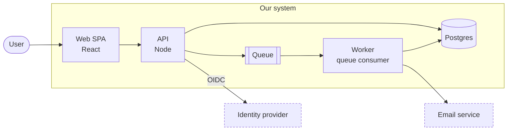

# arc42 Documentation (lightweight)

Architecture docs that live next to the code and stay true because every change updates them. arc42's 12 chapters,
one markdown file each, most of them a few lines. Diagrams are Mermaid inside the markdown. Decisions are ADRs.

Brevity is the rule: a chapter holds only what a new engineer needs and can't read from the code in five minutes.
If it would go stale without anyone noticing, it doesn't belong.

## 1. File layout

```
docs/architecture/
  README.md                         # one paragraph + chapter index + the topology diagram (copy of 05's level 1)
  01-introduction-and-goals.md      # what it does, top 3 quality goals, stakeholders
  02-constraints.md                 # things you didn't choose: tech, org, legal
  03-context-and-scope.md           # system boundary: users and external systems (Mermaid)
  04-solution-strategy.md           # 3–6 bullets: the key ideas, each linking an ADR
  05-building-block-view.md         # the topology: components and how they connect (Mermaid)
  06-runtime-view.md                # 1–3 important flows as sequence diagrams (Mermaid)
  07-deployment-view.md             # where it runs: environments, infra (Mermaid)
  08-crosscutting-concepts.md       # auth, errors, logging, i18n, data model: one short ## each
  09-architecture-decisions.md      # ADR index table only
  10-quality-requirements.md        # quality scenarios that make the goals testable
  11-risks-and-technical-debt.md    # known risks and debt, with a next step each
  12-glossary.md                    # domain terms, one line each
  decisions/
    0001-record-architecture-decisions.md
    NNNN-<kebab-title>.md
```

If the repo already has `docs/`, put it at `docs/architecture/`. Don't spread architecture content across other places;
link to it instead.

## 2. Set it up (once)

1. Create the folder and the 12 files from [references/chapters.md](references/chapters.md). Fill what you know from
   the code now; for the rest write one line: `_Nothing relevant yet._` Never invent content to fill a chapter.
2. Draw the topology in `05-building-block-view.md` (section 4) and copy level 1 into `README.md`.
3. Add ADR 0001 "Record architecture decisions", then one ADR per existing decision that a newcomer would question
   (framework, database, hosting, auth). Template: [references/adr.md](references/adr.md).
4. Make the rule stick: add the snippet below to the repo's `CLAUDE.md` / `AGENTS.md`, and the checkbox to the PR
   template.

```markdown
## Architecture docs
`docs/architecture/` is an arc42 doc. Every change that alters what a chapter says updates that chapter in the same
commit. New or reversed architecture decisions get an ADR in `docs/architecture/decisions/`. Keep it brief.
```

```markdown
- [ ] Architecture docs updated (`docs/architecture/`), or not affected
```

## 3. On every change

Before you finish a change, run this check. Most changes touch nothing; a few touch one chapter; decisions add an ADR.

| The change… | Update |
| --- | --- |
| adds, removes, renames or splits a component, service, package or datastore | 05 diagram + table, README diagram |
| adds or changes an external system, API consumer, or user type | 03 |
| changes an important request flow, job or event chain | 06 |
| changes hosting, environments, regions, CI/CD shape, infra resources | 07 |
| introduces or changes auth, error handling, logging, caching, data model conventions | 08 |
| picks between real alternatives, adds a dependency with lock-in, or reverses an earlier choice | new ADR + 09 index (+ 04 if it's a key idea) |
| adds a hard constraint (compliance, mandated tech, deadline) | 02 |
| creates, pays off or discovers a risk or shortcut | 11 |
| introduces a domain term that's used in code | 12 |
| bug fix, refactor inside a component, styling, tests, copy | nothing |

Rules:
- Update in the **same commit/PR** as the code. A doc fix in a later PR never happens.
- **Edit, don't append.** Rewrite the sentence that became wrong; delete what no longer exists. The docs describe the
  current system; history lives in git and ADRs.
- **Small diffs.** Changing one arrow in the diagram is a one-line edit. Don't re-layout or reword untouched parts.
- If nothing applies, say so in the PR ("Architecture docs: not affected"), don't add filler.

## 4. Mermaid topology

The overall topology lives in `05-building-block-view.md` as a `flowchart`. It's the single source of truth; `README.md`
holds a copy of the same block, kept identical.



Diagram rules:
- **One level per diagram**, 5–12 nodes. More than that: split into a level-2 diagram per component under its own
  `###` in chapter 05.
- Node ids are stable short names (`api`, `db`); labels say name + technology. Datastores `[( )]`, queues `[[ ]]`,
  people `([ ])`, external systems dashed via `classDef ext`.
- Label edges only when the protocol or meaning isn't obvious (`OIDC`, `webhook`, `gRPC`).
- Context (03) uses the same style with the whole system as one node. Runtime (06) uses `sequenceDiagram`.
  Deployment (07) uses `flowchart` with `subgraph` per environment/cloud account.
- Names in diagrams match names in code (directory, service, package names) and the 05 table.
- No styling beyond `classDef ext`. No images, no draw.io exports: they can't be diffed or updated in a PR.

Under the diagram, one table: *Component | Responsibility | Code*. One line per node, `Code` links the directory.

## 5. ADRs

An ADR records one decision that was hard to make or will be questioned later. It's short (≤ 1 page), immutable once
accepted, and superseded rather than edited. Full template and lifecycle: [references/adr.md](references/adr.md).

- File: `decisions/NNNN-<kebab-title>.md`, numbers never reused.
- Status: `Proposed` → `Accepted` → (`Deprecated` | `Superseded by NNNN`). Only the status line of an old ADR ever
  changes.
- Write it when the decision is made, in the PR that implements it, not afterwards.
- `09-architecture-decisions.md` is only an index table: *# | Title | Status | Date*. No summaries there.

Write an ADR for: framework/language/datastore choices, sync vs async boundaries, build vs buy, auth model, hosting,
data ownership, anything you'd explain twice in review. Skip it for: library minor choices, naming, code style.

## 6. Brevity rules

- Chapter budget: most chapters ≤ 40 lines. 05 and 08 may be longer, only because of tables and diagrams.
- Bullets and tables over prose. One idea per bullet.
- Link, don't copy: to code paths, to ADRs, to API specs, to runbooks. Never paste config or code longer than 5 lines.
- No aspirations ("we plan to…") outside 11. No version numbers unless they're a constraint.
- Empty is fine: `_Nothing relevant yet._` beats a paragraph of generic text.
- Don't document what the code says plainly (folder trees, every endpoint, every env var).

## Pitfalls

- Filling all 12 chapters with arc42's help text or generic statements: nobody reads it, and real changes get lost in
  it. Delete anything that would be true of any system.
- Topology in README and chapter 05 drifting apart: update both in the same edit, or have README link to 05.
- Diagrams that show the target architecture instead of the current one. Planned changes go in an ADR (`Proposed`).
- Editing an accepted ADR to reflect a new decision: write a new ADR that supersedes it.
- Docs updated in a follow-up PR "later": they aren't. Same PR or not at all.
- Mermaid that doesn't render: unquoted labels with `()`, `:` or `/` (wrap in `"..."`), `end` as a node id, missing
  `<br/>` self-close. Preview on GitHub before merging.

## Checklist

- [ ] `docs/architecture/` has README + 12 chapter files + `decisions/` with ADR 0001.
- [ ] README has a one-paragraph summary, chapter links and the topology diagram identical to 05.
- [ ] Every diagram node matches a real component; every real top-level component appears.
- [ ] 05 table links each component to its code directory.
- [ ] 04 bullets each link the ADR behind them; 09 lists every ADR with its current status.
- [ ] No chapter contains generic or invented text; unknowns are `_Nothing relevant yet._`.
- [ ] `CLAUDE.md` / `AGENTS.md` carries the update rule; PR template carries the checkbox.
- [ ] This change's diff includes the doc and ADR updates it requires (section 3), or says "not affected".
