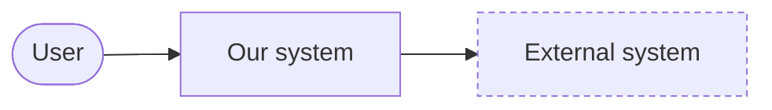
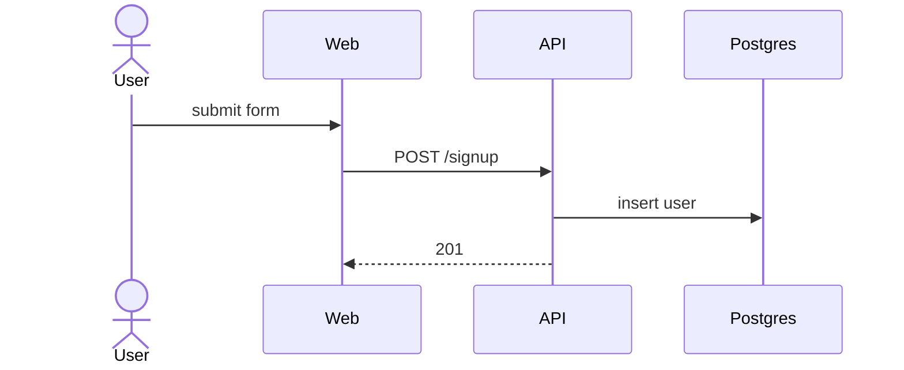
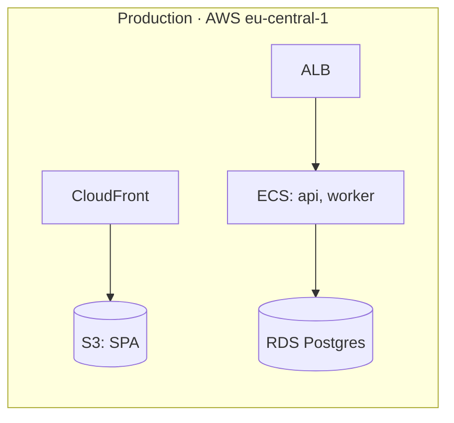

# Chapter skeletons

Starting content for each file in `docs/architecture/`. Replace the placeholders with real, specific content or with
`_Nothing relevant yet._`. Delete any heading that stays empty after the first pass, except the title.

## README.md

````markdown
# Architecture

<One paragraph: what the system does, for whom, and its shape in one sentence (e.g. "an SPA, an API and a worker
sharing one Postgres").>

```mermaid
<identical copy of the level-1 diagram in 05-building-block-view.md>
```

1. [Introduction and goals](01-introduction-and-goals.md)
2. [Constraints](02-constraints.md)
3. [Context and scope](03-context-and-scope.md)
4. [Solution strategy](04-solution-strategy.md)
5. [Building block view](05-building-block-view.md)
6. [Runtime view](06-runtime-view.md)
7. [Deployment view](07-deployment-view.md)
8. [Crosscutting concepts](08-crosscutting-concepts.md)
9. [Architecture decisions](09-architecture-decisions.md)
10. [Quality requirements](10-quality-requirements.md)
11. [Risks and technical debt](11-risks-and-technical-debt.md)
12. [Glossary](12-glossary.md)
````

## 01-introduction-and-goals.md

```markdown
# 1. Introduction and goals

<Two sentences: the problem it solves and for whom.>

## Quality goals

| # | Goal | Why it matters |
| --- | --- | --- |
| 1 | <e.g. Availability: API answers 99.9% of requests> | <e.g. customers' CI depends on it> |

Top 3 only, in priority order. Each one should be testable in chapter 10.

## Stakeholders

| Who | Expects |
| --- | --- |
| <role> | <what they need from the system or these docs> |
```

## 02-constraints.md

```markdown
# 2. Constraints

| Constraint | Reason |
| --- | --- |
| <e.g. Runs on AWS eu-central-1> | <e.g. data residency (GDPR), existing account> |
```

Only constraints you didn't choose. Your own choices are ADRs.

## 03-context-and-scope.md

````markdown
# 3. Context and scope



| Neighbour | Direction | What is exchanged |
| --- | --- | --- |
| <User / system> | in / out | <requests, webhooks, files…> |
````

## 04-solution-strategy.md

```markdown
# 4. Solution strategy

- <Key idea, one line> ([ADR 0003](decisions/0003-....md))
```

3–6 bullets: the decisions that shape everything else (stack, architecture style, data approach, hosting).

## 05-building-block-view.md

````markdown
# 5. Building block view

```mermaid
flowchart LR
  ...level 1 topology...
```

| Component | Responsibility | Code |
| --- | --- | --- |
| API | <one line> | [`apps/api`](../../apps/api) |

## <Component> (level 2)

Only for components complex enough to need it. Same diagram rules, its internals only.
````

## 06-runtime-view.md

````markdown
# 6. Runtime view

## <Flow name, e.g. "Sign-up">



<One or two lines on anything non-obvious: retries, idempotency, async hand-off.>
````

Pick 1–3 flows that are central, cross several components, or surprise people. Not every endpoint.

## 07-deployment-view.md

````markdown
# 7. Deployment view



| Environment | Purpose | Deployed by |
| --- | --- | --- |
| prod | customers | <e.g. GitHub Actions on tag> |
````

Infra-as-code is the source of truth for details; link to it.

## 08-crosscutting-concepts.md

```markdown
# 8. Crosscutting concepts

## Authentication and authorization
<2–5 lines + link to code.>

## Error handling
## Logging and observability
## Data model
```

Only concepts that apply across components and that a newcomer must follow. Delete headings that don't apply.

## 09-architecture-decisions.md

```markdown
# 9. Architecture decisions

| # | Title | Status | Date |
| --- | --- | --- | --- |
| [0001](decisions/0001-record-architecture-decisions.md) | Record architecture decisions | Accepted | 2026-01-15 |
```

## 10-quality-requirements.md

```markdown
# 10. Quality requirements

| Goal | Scenario | Measure |
| --- | --- | --- |
| Availability | API instance dies under normal load | requests keep succeeding; < 1 min to replace |
```

One to three scenarios per goal from chapter 1. A scenario is stimulus + expected response + how you'd check it.

## 11-risks-and-technical-debt.md

```markdown
# 11. Risks and technical debt

| Risk / debt | Impact | Next step |
| --- | --- | --- |
| <e.g. Single Postgres instance> | <outage on failure> | <Multi-AZ when revenue > X> |
```

Remove rows when resolved; the commit is the record.

## 12-glossary.md

```markdown
# 12. Glossary

| Term | Meaning |
| --- | --- |
| <domain term as used in code> | <one line> |
```
