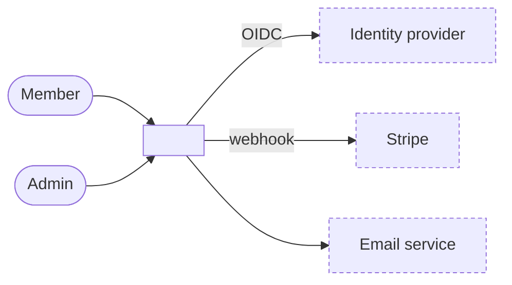
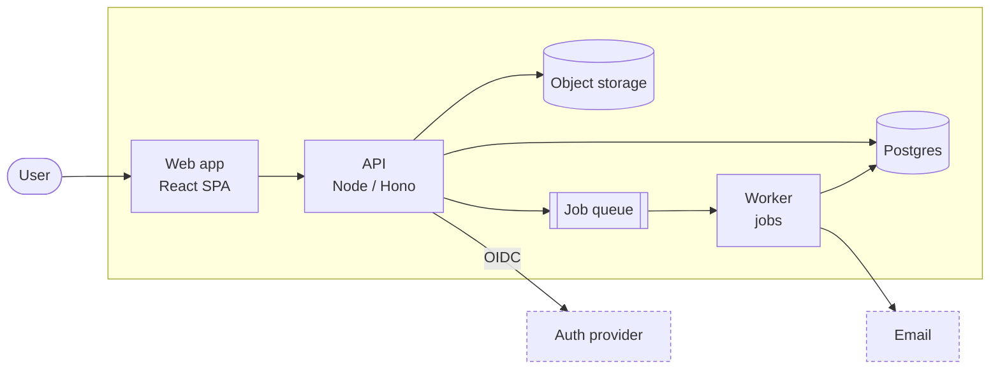

# Spec templates

Layout matches `arc42-documentation`, so the folder can become the maintained architecture doc once code exists.
Budget: most chapters ≤ 30 lines. Bullets and tables over prose. `_Nothing relevant yet._` for empty chapters.

## README.md

```markdown
# <Product> — Architecture spec

<One paragraph: what the system is, for whom, the shape of the solution in one sentence.>
Product requirements: [PRD](../PRD.md) · Prototype: [`prototype/`](../../prototype/)

## Topology
<identical copy of the 05 level-1 diagram>

## Tech stack
| Layer | Choice |
| --- | --- |
<short version of the 04 table, without the Why column>

## Chapters
1. [Introduction and goals](01-introduction-and-goals.md)
…
12. [Glossary](12-glossary.md)

Decisions: [ADR index](09-architecture-decisions.md)
```

## 01 Introduction and goals

```markdown
# 1. Introduction and goals
<2–3 lines; link the PRD instead of repeating it.>

## Quality goals
| # | Goal | Why it matters | Scenario |
| --- | --- | --- | --- |
| 1 | <e.g. Responsiveness> | <one line> | [10](10-quality-requirements.md) |
_Top 3 only._

## Stakeholders
| Role | Expects from the architecture |
| --- | --- |
```

## 02 Constraints

Table *Constraint | Type (technical / organisational / legal) | Source*. Only things nobody gets to choose: team
skills, mandated vendors, budget, deadline, regulation, region.

## 03 Context and scope

````markdown
# 3. Context and scope



| Partner | Exchanges | Interface |
| --- | --- | --- |
````

## 04 Solution strategy

```markdown
# 4. Solution strategy

## Key ideas
- <3–6 bullets, e.g. "Managed Postgres with row-level security enforces tenant isolation — [ADR-0004](decisions/0004-…)">

## Tech stack
| Layer | Choice | Why | ADR |
| --- | --- | --- | --- |
| Frontend | React + Vite (SPA) | team knows it; prototype reused for screens | [0002](decisions/0002-…) |
| Backend | … | … | … |
| Data | … | … | … |
| Auth | … | … | … |
| Async / jobs | … | … | … |
| File storage | … | … | … |
| Hosting | … | … | … |
| CI/CD | … | … | — |
| Observability | … | … | — |
| Third-party services | … | … | … |
```

Rows with no real decision behind them (an obvious default) may have `—` as ADR. Every row with alternatives worth
discussing has one.

## 05 Building block view

````markdown
# 5. Building block view



| Component | Responsibility | Owns FRs |
| --- | --- | --- |
| web | screens from the prototype; client-side validation | FR-1, FR-2, FR-4 |
| api | business rules, permissions, persistence | FR-3, FR-5–FR-9 |
| worker | reminders, exports | FR-10, FR-11 |
````

5–12 nodes. Datastores `[( )]`, queues `[[ ]]`, people `([ ])`, external dashed. Labels: name + technology.

## 06 Runtime view

1–3 `sequenceDiagram`s for the flows where the interesting things happen: the core loop, anything async, anything
crossing an external system. Skip trivial CRUD.

## 07 Deployment view

`flowchart` with a `subgraph` per environment or provider. Table *Environment | Purpose | URL/how deployed*.

## 08 Crosscutting concepts

One short `##` each, only the ones that apply: Authentication & authorisation, Data model (entities and key
relations as a `erDiagram` without attributes or a bullet list), Error handling, Logging & monitoring, Validation,
i18n, Privacy (retention, deletion, export).

## 09 Architecture decisions

```markdown
| # | Title | Status | Date |
| --- | --- | --- | --- |
| [0001](decisions/0001-record-architecture-decisions.md) | Record architecture decisions | Accepted | <date> |
```

## 10 Quality requirements

One row per NFR worth testing: *Scenario | Stimulus | Expected response | NFR id*. "100 members open the board at
9:00 → board loads < 2 s p95 → NFR-2".

## 11 Risks and open questions

| # | Risk or question | Impact | Next step | Owner | Decide by |
| --- | --- | --- | --- | --- | --- |

Include every feasibility risk the user chose to accept rather than simplify.

## 12 Glossary

Domain terms in one line each — or a single line linking the PRD if it already defines them.

## ADR template (`decisions/NNNN-kebab-title.md`)

```markdown
# NNNN. <Decision as a short phrase, e.g. "Use Supabase for auth and data">

Status: Accepted | Proposed · Date: <YYYY-MM-DD> · Decided by: <user / agent default>

## Context
<2–5 lines: the forces — requirement ids, constraints, interview answer.>

## Options
1. **<Chosen>** — <pros> / <cons>
2. **<Alternative>** — <pros> / <cons>
3. **<Alternative>** — <pros> / <cons>

## Decision
<One or two sentences.>

## Consequences
- <What gets easier>
- <What gets harder / what we're locked into>
- <Revisit when: concrete trigger, e.g. "> 50k MAU" or "need for SSO">
```

ADR 0001 is always "Record architecture decisions" (context: decisions made before code exists must survive into
implementation; decision: ADRs in `decisions/`, immutable once accepted, superseded by new ones).

Typical ADR set for a new product: 0001 record decisions · hosting · frontend framework · backend/runtime ·
data store · auth · async/real-time · each buy-vs-build for a major service · tenancy (if multi-org).
